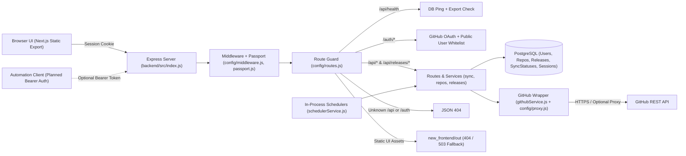

# Architecture Overview

This file gives the five-part architectural map of `my-gitstars`. For detailed backend implementation rationale and edge cases, see [docs/architecture.md](docs/architecture.md); for every HTTP endpoint and response schema, see [docs/api.md](docs/api.md).

## 1. Purpose, Core Promises & Out-of-Scope Boundaries

`my-gitstars` serves self-hosting individuals and small teams who want searchable organization, private markdown notes, and release update tracking over their GitHub repositories without sending personal annotations to third-party services.

- **Core promises**:
  1. **Local data ownership**: All repository snapshots, custom tags, private notes, version selections, and sessions live in your PostgreSQL database.
  2. **Non-destructive star sync**: Syncing with GitHub preserves hand-authored tags, notes, and version choices even when a repository is unstarred or GitHub returns an empty list.
  3. **Actionable release tracking**: Tracks latest published releases against your chosen running version, computes update flags, and builds copyable changelogs.
  4. **Single-container operation**: One Express process serves both `/api/*` and the statically exported Next.js app from the same origin, with no separate worker or cache server.
- **Explicit scope boundary**: `my-gitstars` handles GitHub repository metadata, annotations, release tracking, and JSON export/import; it leaves package installation, infrastructure orchestration, and multi-tenant billing outside its scope.

## 2. End-to-End Runtime Flow & Failure Handling

- **Star sync safety**: `POST /api/sync` takes `pg_advisory_xact_lock(4242, userId)` to prevent duplicate runs, starts `backgroundSync` in `t.afterCommit`, and marks stale runs failed after `SYNC_STALE_AFTER_MS`. An empty star response skips unfollow reconciliation and records the warning in `SyncStatus.error`.
- **Release fetch resilience**: `releaseService.js` caches releases in PostgreSQL for 24 hours, drops drafts, prunes deleted releases only within the fetched window, and backs off 30 minutes on errors (`releasesFetchError`) rather than hiding failures.
- **GitHub network & README fallback**: `githubService.js` enforces 30 s timeouts, retries transient 429/5xx/network errors, respects `Retry-After` (capped at 60 s), pauses below 100 remaining rate-limit calls, and applies container loopback proxy rewriting via `config/proxy.js`. README fetches use a per-user in-process LRU cache (6 h TTL) that falls back to stale entries during GitHub outages.
- **Client error visibility**: `new_frontend/lib/api.ts` throws `ApiError` on every non-2xx response (routing to `/` on `401`) so failures surface directly instead of falling back to fake data.

## 3. Bounded Subsystems, Interfaces & Forbidden Couplings

| Subsystem | Paths | Narrow Interface | Detailed Reference |
|---|---|---|---|
| **HTTP Boot, Auth & Routing** | `backend/src/index.js`, `config/`, `middleware/auth.js`, `routes/auth.js` | Express app, session middleware, `ensureAuth`, `/auth/*`, `/api/health` | [docs/architecture.md](docs/architecture.md#request-lifecycle) |
| **Repo, Tag, Note & Export API** | `backend/src/routes/repos.js`, `backend/src/lib/tags.js` | `/api/repos*`, `/api/stats`, `/api/tags*`, `/api/export`, `/api/import` | [docs/api.md](docs/api.md#repositories) |
| **Sync, Releases & Schedulers** | `backend/src/routes/sync.js`, `routes/releases.js`, `services/` | `/api/sync*`, `/api/releases/*`, `startSchedulers()` -> `stop()` handle | [docs/architecture.md](docs/architecture.md#star-sync) |
| **Persistence & Migrations** | `backend/src/models/index.js`, `backend/migrations/` | Sequelize models and reversible `sequelize-cli` migrations | [docs/architecture.md](docs/architecture.md#data-model) |
| **Frontend Shell & Components** | `new_frontend/app/`, `new_frontend/components/` | Static routes `/` and `/dashboard/`, props-driven views | [docs/frontend.md](docs/frontend.md#structure) |
| **Frontend Logic & API Client** | `new_frontend/lib/` | Pure filter/expression/format functions, `types.ts`, `api.ts` | [docs/frontend.md](docs/frontend.md#filtering) |

### Forbidden Couplings

| Forbidden coupling | Why banned | Where enforced |
|---|---|---|
| Returning `User.accessToken` in any HTTP response or log | Exposes user GitHub credentials to browser scripts | `publicUser` whitelist in `backend/src/routes/auth.js` |
| Unscoped `Repo.findByPk(id)` reads without verifying `UserId` | Leaks or mutates another user's private notes and tags | Query scoping in routes and ownership check in `releaseService.js` |
| Unknown `/api/*` or `/auth/*` falling through to SPA HTML | Causes client JSON parsing crashes on missing endpoints | API 404 guard registered before static handler in `config/routes.js` |
| Schema changes via `sequelize.sync()` instead of migrations | Breaks production upgrades and rollback safety | Manual `backend/migrations/` + CI rollback check |
| Hard-coded Tailwind colors or unsanitized `style` in README HTML | Breaks dark theme and lets untrusted READMEs spoof UI | Semantic tokens in `globals.css`; `rehype-sanitize` in `markdown.tsx` |
| Complex filter/domain logic inside React component closures | Makes behavior untestable without a browser harness | Pure tested modules in `new_frontend/lib/` |

## 4. Authoritative State Owners & Hard Invariants

| State or fact | Single authoritative owner | Hard invariant |
|---|---|---|
| Accounts, OAuth tokens, sessions | PostgreSQL `Users` & `Sessions` (`backend/migrations/`, `config/passport.js`) | `accessToken` stays server-side; OAuth `state: true`; allow-listed CORS |
| Starred repos, tags, notes, versions | PostgreSQL `Repos` (`backend/src/models/index.js`, `backend/migrations/`) | Unique on `(UserId, githubId)`; sync never deletes rows or overwrites user columns |
| Release cache & update flags | PostgreSQL `Releases` & `Repos` version fields (`releaseService.js`) | Unique on `(repoId, githubReleaseId)`; `null` `currentlyUsedVersion` suppresses updates |
| Sync progress & concurrency lock | PostgreSQL `SyncStatuses` + `pg_advisory_xact_lock` (`syncService.js`) | Last completed sync is queried from history rather than duplicated |
| Runtime configuration | Environment variables ([.env.example](.env.example), [docs/configuration.md](docs/configuration.md)) | `APP_URL` validated as bare origin at boot; required secrets fail fast |
| Shared frontend data shapes | [new_frontend/lib/types.ts](new_frontend/lib/types.ts) (matches [docs/api.md](docs/api.md#objects)) | `ignoreBuildErrors` and `ignoreDuringBuilds` stay `false` |
| Governance policy & active roadmap | [docs-policy.toml](docs-policy.toml) and [docs/work.toml](docs/work.toml) | Version, budgets, and task states live only in these files |

## 5. Entrypoints & Verification Checks

- **Working rules & legacy debt**: [AGENTS.md](AGENTS.md)
- **Backend internals & data invariants**: [docs/architecture.md](docs/architecture.md)
- **HTTP API contract**: [docs/api.md](docs/api.md)
- **Frontend structure & theming**: [docs/frontend.md](docs/frontend.md)
- **Operations & configuration**: [docs/configuration.md](docs/configuration.md), [docs/deployment.md](docs/deployment.md), [docs/troubleshooting.md](docs/troubleshooting.md)
- **Roadmap & discipline adoption**: [docs/work.toml](docs/work.toml), [docs/discipline-adoption.md](docs/discipline-adoption.md)
- **Automated gates** (from [docs/development.md](docs/development.md) and [.github/workflows/docker-image.yml](.github/workflows/docker-image.yml)):
  - Frontend: `cd new_frontend && npm run typecheck && npm run lint && npm test && npm run build`
  - Backend (with PostgreSQL running via `docker compose --profile local-db up -d db`): `cd backend && npm run check && DB_HOST=127.0.0.1 DB_PORT=25432 npm run migrate && DB_HOST=127.0.0.1 DB_PORT=25432 npm test` (0 skipped)
  - Container smoke check: `docker compose --profile local-db up --build` and verify `GET /api/health`
